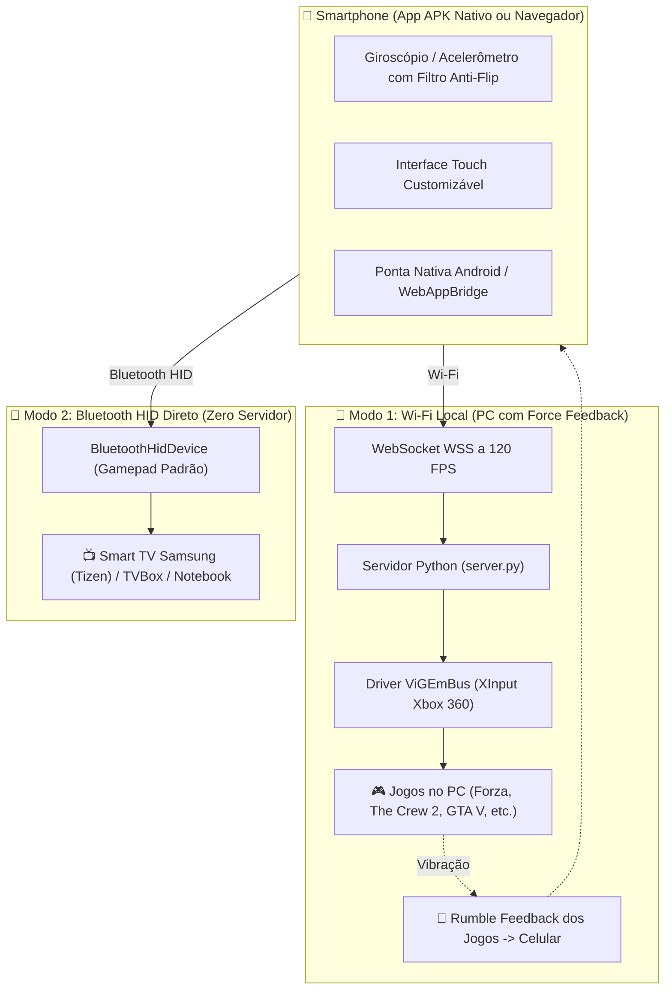

# 🏎️ Remote Wheel & Gamepad (Mobile ➔ PC & Smart TV Controller)

Transforme qualquer smartphone (Android / iOS) em um **Volante de Corrida por Acelerômetro** e um **Gamepad Completo estilo Xbox 360** com suporte **Dual Mode**:
1. **Computador (Wi-Fi):** Com **Force Feedback háptico real vindo dos jogos**, transmissão a 60-120 FPS e emulação nativa no Windows via **ViGEmBus (XInput)**.
2. **Smart TV & Dispositivos Bluetooth (Sem Servidor):** O aplicativo Android nativo emula um controle de videogame padrão via **Bluetooth HID (`BluetoothHidDevice`)**, conectando direto em **Smart TVs Samsung (Tizen OS)**, **TVBox (Android)** e **Notebooks** sem precisar instalar nada na TV!

---

## ✨ Recursos Principais

- 🏎️ **Modo Volante de Corrida (Racing Wheel):**
  - Esterçamento ultrapreciso com acelerômetro/giroscópio, **filtro anti-flip (anti-gimbal lock)** e **batente físico de 90°** (nunca vira de ponta-cabeça).
  - Curva de resposta progressiva para retas firmes e agilidade em chicanes (calibrado para *The Crew 2, Forza Horizon, Need for Speed, Assetto Corsa*).
  - Pedais dedicados de Aceleração (`RT`) e Freio/Ré (`LT`).
  - Botões de Nitro (`X`), Freio de Mão (`A`), Troca de Marchas (`LB`/`RB`), Câmera (`Y`) e Pausa.
  - Centralização instantânea do volante com 1 toque.

- 🎮 **Modo Gamepad Completo (Xbox Style):**
  - Layout clássico com D-Pad em disco, Dual Sticks analógicos (LS / RS) com resposta 360°.
  - Botões de Ação ABXY, Gatilhos analógicos (`LT`/`RT`), Bumpers (`LB`/`RB`), Cliques dos analógicos (`L3`/`R3`), Menu (`Start`), Visão (`Select`) e botão **Xbox Guide / Home**.

- 📳 **Force Feedback Real (Rumble Háptico):**
  - Lê a vibração dos jogos no Windows via driver ViGEmBus e faz o motor do smartphone vibrar sincronizado com batidas, aceleração e zebras na pista!

- 📶 **Modo Bluetooth HID Direto (Smart TV & TVBox):**
  - O celular se transforma em um periférico Bluetooth oficial padrão (`Remote Gamepad`).
  - Conecte diretamente em Smart TVs Samsung, Android TV, TVBox ou notebooks sem precisar de servidor rodando.

- ✏️ **Editor de Layout Customizável (HUD Drag & Drop):**
  - Mova qualquer botão ou analógico livremente pela tela.
  - Altere o tamanho individual de cada botão de 50% a 180%.
  - Adicione ou remova botões da interface conforme a sua preferência.

- 🎨 **Personalização Estética & Temas Neon:**
  - 8 Temas prontos: *Crimson Red, Cyber Cyan, Xbox Green, Vaporwave Purple, Racing Gold, McLaren Orange, Stealth Carbon e Neon Pink*.
  - Seletor de cores livre (Color Picker RGB) e controle de brilho neon glow.

---

## 🛠️ Arquitetura

---

## 🚀 Como Baixar e Usar

### Opção 1: Usando no Computador (Windows)

1. Baixe o pacote **`RemoteWheel-v0.1.0-Windows.zip`** na [página de Releases](https://github.com/1newsgamee/RemoteWheel/releases).
2. Extraia a pasta e execute **`iniciar_remotewheel.bat`**.
3. O servidor abrirá um link com **QR Code** no terminal:
   - Abra a câmera do celular ou digite o link no navegador do smartphone.
   - Ou baixe o **`RemoteWheel.apk`** para ter o app instalado diretamente no celular!

> **Dica para Force Feedback:** Certifique-se de ter o driver [ViGEmBus instalado](https://github.com/nefarius/ViGEmBus/releases) no PC (o instalador padrão de controles virtuais).

---

### Opção 2: Usando direto na TV Samsung, TVBox ou Notebook (Bluetooth)

1. Baixe e instale o **`RemoteWheel.apk`** no seu smartphone Android.
2. Abra o app, toque na aba superior **"📶 TV (Bluetooth)"**.
3. Toque em **"Tornar Celular Visível na TV (Parear)"**.
4. Na sua TV Samsung (ou TVBox):
   - Vá em **Configurações ➔ Conexões ➔ Dispositivos Externos ➔ Gerenciador de Dispositivos ➔ Controle Bluetooth**.
   - Selecione **"Remote Gamepad"** e confirme!

---

## 📄 Licença

Distribuído sob a licença **MIT**. Veja [LICENSE](LICENSE) para mais detalhes.
