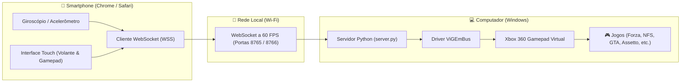

# 🏎️ Remote Wheel & Gamepad (Mobile ➔ PC Virtual Controller)

Transforme qualquer smartphone (Android / iOS) em um **Volante de Corrida por Acelerômetro** e um **Gamepad Completo estilo Xbox 360** para PC via Wi-Fi em rede local, com **zero instalação no celular** (PWA / Web App) e emulação nativa no Windows via **ViGEmBus (XInput)**.

---

## ✨ Recursos Principais

- 🏎️ **Modo Volante de Corrida (Racing Wheel):**
  - Vira o volante usando o giroscópio e acelerômetro do smartphone com resposta analógica fluida.
  - Filtro passa-baixa configurável para eliminar ruídos e tremidos das mãos.
  - Pedais dedicados de Aceleração (Gatilho `RT`) e Freio / Ré (Gatilho `LT`).
  - Botão de Freio de Mão (`A`), Nitro (`X`), Marchas (`LB`/`RB`), Câmera (`Y`) e Pausa.
  - Botão de calibração rápida com 1 toque e alternador de sentido (`Inverter`).

- 🎮 **Modo Gamepad Completo (Xbox Style):**
  - Layout clássico com D-Pad em disco, Dual Sticks analógicos (LS / RS) com resposta 360°.
  - Botões de Ação ABXY, Gatilhos analógicos (`LT`/`RT`), Bumpers (`LB`/`RB`), Cliques dos analógicos (`L3`/`R3`), Menu (`Start`) e Visão (`Select`).

- ✏️ **Editor de Layout Customizável (HUD Editor):**
  - **Arraste e Solte (Drag & Drop):** Posicione qualquer controle em qualquer lugar da tela do celular.
  - **Redimensionamento:** Ajuste a escala de cada botão/analógico individualmente de 50% a 180%.
  - **Adicionar / Remover Botões:** Oculte botões desnecessários para criar layouts minimalistas.
  - Todas as personalizações ficam salvas no próprio smartphone (`localStorage`).

- 🎨 **Personalização Estética & Temas:**
  - 8 Temas prontos: *Crimson Red, Cyber Cyan, Xbox Green, Vaporwave Purple, Racing Gold, McLaren Orange, Stealth Carbon e Neon Pink*.
  - Seletor de cores livre (Color Picker RGB) e controle de intensidade de brilho (Glow neon).

- 🔒 **Conexão Segura e Rápida (HTTPS & WSS):**
  - Servidor em Python com geração automática de certificado SSL autoassinado, atendendo à exigência do W3C para desbloquear a API de sensores de movimento no Google Chrome e Safari.
  - Latência ultrabaixa com transmissão a 60 FPS via WebSockets.

---

## 🛠️ Arquitetura



---

## 🚀 Como Instalar e Rodar

### Pré-requisitos
- **Windows 10 ou 11**
- **Python 3.10+**
- Celular conectado na **mesma rede Wi-Fi** do computador.

### 1. Clonar o Repositório e Instalar Dependências
```bash
git clone https://github.com/SEU-USUARIO/RemoteWheel.git
cd RemoteWheel

pip install -r requirements.txt
```

### 2. Iniciar o Servidor
Execute o script `.bat` ou execute via terminal:
```bash
python server.py
```

O console exibirá o link seguro e um **QR Code**:
```text
👉 https://192.168.X.X:8443
```

### 3. Conectar no Celular
1. Aponte a câmera do celular para o QR Code (ou digite a URL no Chrome do celular).
2. Como o certificado local é autoassinado, toque em **"Avançado"** ➔ **"Ir para o endereço (não seguro)"**.
3. Deite o celular na horizontal e divirta-se!

---

## 📄 Licença

Distribuído sob a licença **MIT**. Veja `LICENSE` para mais informações.
